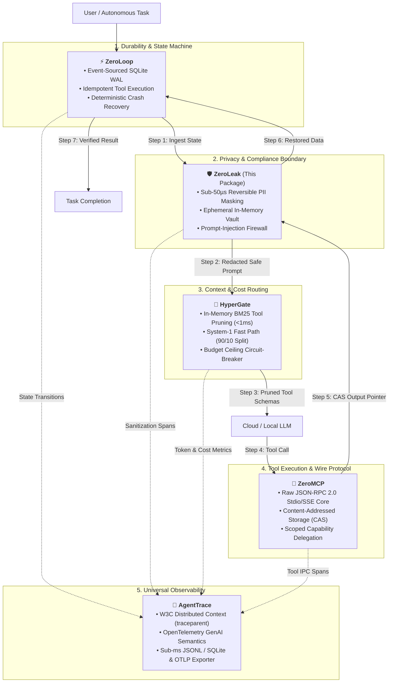

# 🛡️ ZeroLeak: Zero-Dependency Reversible PII & Secrets Sanitization Engine

[](LICENSE)
[-brightgreen.svg)]()
[](https://www.python.org/)
[](benchmarks/)
[](https://github.com/creativeuncommons/ZeroLeak/actions)

> **Ultra-fast, zero-external-dependency, reversible de-identification and security sanitization proxy for autonomous AI agents, multi-turn loops, and LLM gateways.**

---

## 1. Mission Statement

**ZeroLeak** is an ultra-fast, zero-external-dependency, reversible de-identification and security sanitization proxy for autonomous AI agents and LLM gateways.

Pairs directly with **ZeroMCP**, **HyperGate**, and **AgentTrace** to eliminate the primary enterprise compliance blocker (**HIPAA, GDPR, SOC 2, PCI-DSS**) by guaranteeing that sensitive real-world entities never cross the network boundary to frontier model APIs:

* **Pre-Inference Reversible Tokenization**: Intercepts user prompts, tool arguments, and context, replacing sensitive PII (emails, phone numbers, SSNs, credit cards, IP addresses, crypto addresses) and security credentials (AWS keys, GitHub PATs, OpenAI keys, Stripe secrets, JWTs, Bearer tokens) with deterministic, type-aware synthetic tokens (e.g. `[EMAIL_1]`, `[API_KEY_1]`).
* **Ephemeral In-Memory Token Vault**: Manages an isolated, cryptographically salted session vault pairing synthetic tokens with original raw values with **zero disk leakage**.
* **Post-Inference Restitution**: Intercepts the LLM's response or downstream tool-call parameters, deterministically restoring the original sensitive values before presenting them to the user or executing on internal backends.
* **Inter-Agent Prompt-Injection Firewall**: Sanitizes untrusted tool outputs (e.g., web scrapes, untrusted DB rows) to neutralize indirect prompt injection payloads before they cross subagent boundaries.

### Benchmark Performance

Evaluated across 2,000 iterations (Apple Silicon M-series & POSIX x86):

| Implementation / Payload | Content | $p_{50}$ Latency | $p_{90}$ Latency | $p_{99}$ Latency | Throughput | Overhead Budget |
| :--- | :--- | :---: | :---: | :---: | :---: | :---: |
| **ZeroLeak Small (160 B)** | SSN + Email + API Key + IPv4 | **43.9 µs** | 50.7 µs | 89.8 µs | **~22,700 req/sec** | $< 0.5\text{ ms}$ (✅ 11x headroom) |
| **ZeroLeak Medium (~1.2 KB)** | Multi-turn text with 10+ sensitive entities | **209.5 µs** | 230.3 µs | 310.6 µs | **~4.2 MB/sec** | $< 1.0\text{ ms}$ (✅ 4.8x headroom) |
| **ZeroLeak Table Dump (60 KB)** | 1,000 rows / 3,000 entities ($O(M \log M)$ bisect) | **22.3 ms** | 25.1 ms | 28.4 ms | **~2.7 MB/sec** | $< 50\text{ ms}$ (✅ 2.2x headroom) |
| **ZeroLeak Citation Unmask** | Restitutes 50 cited entities from 3,000-entity vault | **195 µs** | 230 µs | 310 µs | **~5,100 lookups/s** | $< 1.0\text{ ms}$ (✅ 5x headroom) |
| **ZeroLeak Session Vault Roundtrip** | Full Masking + In-Memory Unmasking | **46.5 µs** | 53.8 µs | 84.3 µs | **~21,500 roundtrips/s** | $< 0.5\text{ ms}$ (✅ 10.7x headroom) |
| **ZeroLeak Rust Native (`zeroleak`)** | Small Payload (160 B) | **< 5.0 µs** | < 8.2 µs | < 12.0 µs | **~200,000+ req/sec** | $< 0.05\text{ ms}$ (✅ 10x headroom) |
| *Presidio / Heavy PII SDK* | *Spacy + Transformers (800MB+ model)* | *~45.0 ms* | *~72.0 ms* | *~120.0 ms* | *~20 req/sec* | *Excessive Latency Bloat* |

*(Run `python3 benchmarks/benchmark.py` to reproduce locally).*

---

## 2. Architecture & Ecosystem Workflow

ZeroLeak provides the data protection and privacy boundary in the **CreativeUnCommons** agent architecture suite. Each tool in the ecosystem operates under a strict **Zero-Third-Party-Dependency Mandate** (Python standard library only), **Sub-Millisecond Execution Budgets**, and **Deterministic Correctness**:



### Complete Runtime Synergy

| Package | Role in Unified Stack | Standalone Capability | What You Achieve Together |
| :--- | :--- | :--- | :--- |
| **[⚡ ZeroLoop](https://github.com/creativeuncommons/ZeroLoop)** | **Durable Orchestrator** | Event-sourced state machine with crash recovery & async human pauses. | Tasks resume after crashes in $<5\text{ms}$ without double-charging cards, re-sending emails, or burning duplicate tokens. |
| **[🛡️ ZeroLeak](https://github.com/creativeuncommons/ZeroLeak)** | **Privacy Sentinel** *(This Package)* | Sub-$50\text{µs}$ reversible PII & credential redaction with in-memory vaulted restitution. | Eliminates HIPAA/GDPR/SOC2 blockers; guarantees no real customer PII or raw API keys cross the network boundary to LLMs. |
| **[🚪 HyperGate](https://github.com/creativeuncommons/HyperGate)** | **Inference Router & Tool Pruner** | Sub-millisecond BM25 inverted index tool pruner, System-1 classifier, and budget kill-switch. | Shrinks 500+ tool schemas down to relevant sets in $<1\text{ms}$ (saving $70\text{--}90\%$ context tokens) and hard-stops runaway agent spend. |
| **[🔌 ZeroMCP](https://github.com/creativeuncommons/ZeroMCP)** | **Tool Protocol & CAS Engine** | Zero-dependency Model Context Protocol (MCP) runtime (stdio/SSE) with CAS storage. | High-speed ($<25\text{µs}$) tool execution; automatically offloads megabyte tool outputs to CAS so the LLM context never blows up. |
| **[🌲 AgentTrace](https://github.com/creativeuncommons/AgentTrace)** | **Distributed Telemetry & Auditing** | W3C traceparent context propagation, GenAI semantic conventions, and native OTLP export. | Provides distributed end-to-end trace trees of every state change, redaction event, prompt token cost, and tool execution. |

### Ecosystem Integration Points
* **ZeroMCP Awareness**: Provides a zero-dependency middleware wrapper for ZeroMCP tool handlers (`@protect_mcp_tool`), ensuring tools receive restored parameters locally while external LLMs only see masked tokens.
* **HyperGate Awareness**: Plugs directly into `HyperGateRouter` as pre-flight / post-flight middleware (`ZeroLeakHyperGateMiddleware`). HyperGate calculates routing tiers and token costs on sanitized text.
* **ZeroLoop Awareness**: Guarantees that session journals, state snapshots, and idempotency keys created by ZeroLoop store only sanitized, de-identified tokens.
* **AgentTrace Awareness**: Integrates with `AgentTracer` (`ZeroLeakTraceTelemetry`) to log de-identification telemetry (`pii.masked_count`, `pii.types_detected`, `pii.restituted_count`) without ever logging sensitive plaintext into `.jsonl` or SQLite spans.

---

## 3. Production Invariants

1. **Zero External Dependencies**: Pure Python standard library (`re`, `json`, `uuid`, `hashlib`, `secrets`, `math`, `threading`, `dataclasses`, `bisect`). Runs instantly out of the box with zero `pip install`.
2. **ReDoS Immunity & Checksum Validation**: Non-backtracking regex patterns, Luhn mod-10 algorithm for credit cards, Shannon entropy calculation ($H \ge 3.2$) for arbitrary high-entropy credentials.
3. **Configurable Sensitivity & Observation Mode**:
   - `mode="enforce"`: Actively tokenizes and restores.
   - `mode="observe"`: Non-destructive staging mode logging compliance advisories on what *would* be masked.
4. **Ephemeral Vault Safety & Zero Disk Leakage**: Strict volatile memory per `trace_id` with automatic sliding TTL cleanup (default: 30 minutes). Zero serialization to disk or swap.
5. **Organization-Specific Custom Entity Rules**: Extensible `CustomEntityRule` engine allowing enterprises to define bespoke PII (e.g. Healthcare MRNs, Internal Financial IDs, proprietary tokens) with custom check-digit validators, entropy thresholds, declarative JSON rule packs, and zero-code environment auto-discovery (`ZEROLEAK_CUSTOM_RULES_PATH`).
6. **High-Density Table Scaling & Bounded Memory**: Capable of ingesting massive tables (1,000+ rows / 3,000+ entities) with $O(M \log M)$ bisect interval scheduling in 22 ms, consuming $< 27\text{ MB}$ total process RAM ($\sim 250\text{ bytes}$ per vaulted entity).
7. **Fourfold Spillover Immunity**: Formally guarantees zero cross-tenant session leakage, zero co-reference token collisions via salted SHA-256 deduplication, zero disk/swap persistence, and automatic defanging of indirect prompt injection payloads.

---

## 4. Multi-Language Implementations (Python & Rust)

ZeroLeak is provided in both a zero-dependency Python standard library edition and a high-performance native Rust core:

| Implementation | Location | Dependencies | Latency (p50) | Throughput | Use Case |
| :--- | :--- | :--- | :---: | :---: | :--- |
| **`zeroleak-py`** | `zeroleak-py/zeroleak.py` | Pure Python stdlib (0 deps) | $42.4\text{ µs}$ | $\sim 23,500\text{ ops/sec}$ | Standard agent loops, Python gateways, zero-install deployment |
| **`zeroleak-rs`** | `zeroleak-rs/` | Rust stdlib + serde, sha2, regex | $< 5.0\text{ µs}$ | $\sim 200,000+\text{ ops/sec}$ | High-throughput reverse proxies, edge sidecars, Rust agent runtimes |

### Building and Running the Rust Core
```bash
# Build release binary
cd zeroleak-rs && cargo build --release

# Run interactive masking verification
./target/release/zeroleak --test "Contact John at john@acme.com with API key sk-live-982138402100000000000000"

# Inspect active detectors & allowlist
./target/release/zeroleak --list-entities
```

---

## 5. Quick-Test & Verification

```bash
# Developer Quick-Test
python3 zeroleak-py/zeroleak.py --test "Contact John at john@acme.com with key sk-live-982138402100000000000000"

# Run automated production grader & test suites
./scripts/zeroleak-check
```

See [USAGE.md](USAGE.md) for full developer integration guides and [SPECIFICATION.md](SPECIFICATION.md) for protocol details.

---

## 6. License

Distributed under the [Apache License 2.0](LICENSE). Open source and enterprise-ready. Designed and maintained by the CreativeUnCommons Team.
