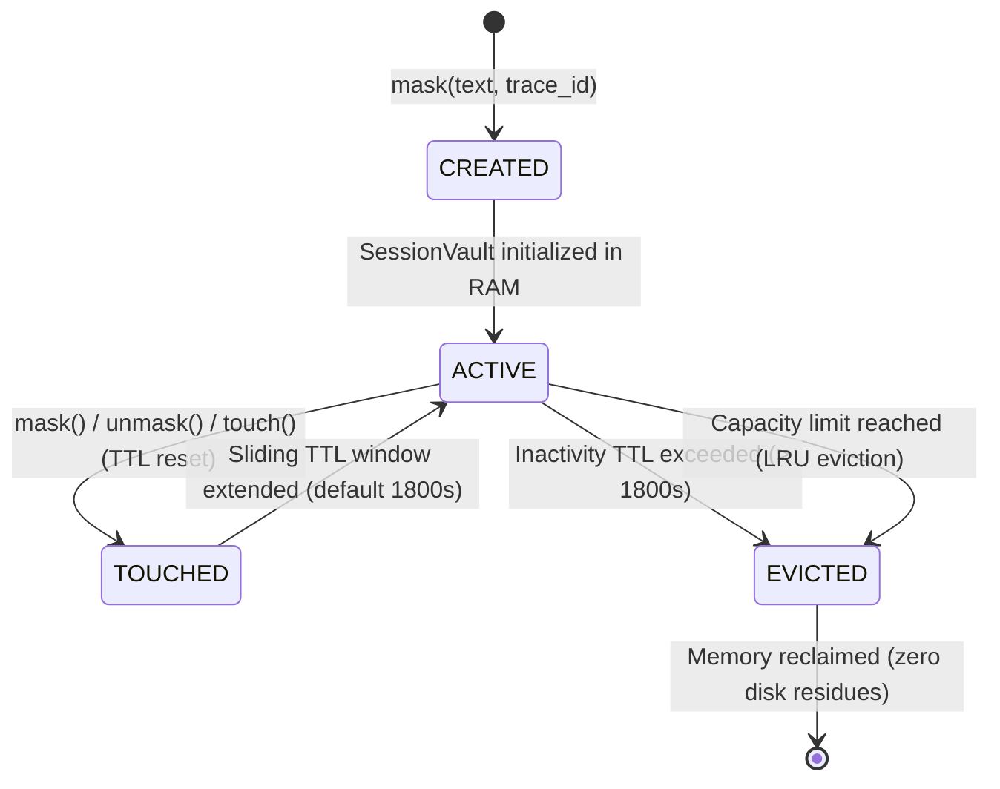

# ZeroLeak Specification & Technical Architecture

## 1. Overview & Objectives

**ZeroLeak** is an ultra-fast, zero-external-dependency, reversible de-identification and security sanitization engine for autonomous AI agents, tool invocation graphs, and LLM gateways.

### Primary Compliance Mandates
* **HIPAA / GDPR / SOC 2 / PCI-DSS**: Guarantee that sensitive real-world entities (SSNs, credit card numbers, emails, phone numbers, API credentials, private tokens) never cross the network boundary to frontier model APIs.
* **Deterministic Reversibility**: Maintain full co-reference fidelity during multi-turn LLM reasoning, allowing local tools and downstream client presentations to reconstruct authentic plaintext deterministically.

---

## 2. Core Architectural Invariants

### Invariant 1: Zero External Dependencies
* The engine must execute entirely on the Python standard library (`re`, `json`, `uuid`, `secrets`, `hashlib`, `math`, `threading`, `dataclasses`).
* No binary C-extensions or external wheels required.
* Cold-start execution overhead is less than $1$ millisecond.

### Invariant 2: ReDoS Immunity & Mathematical Bounds
* Regex patterns must be structurally immune to catastrophic backtracking.
* Numerical credentials (credit cards) require verification through the Luhn Algorithm (Mod-10).
* Arbitrary credential detection requires Shannon entropy evaluation ($H \ge 3.2$ bits/symbol) to avoid false-positive masking on natural language tokens.

### Invariant 3: Ephemeral Vault Isolation & Zero Disk Leakage
* The mapping between synthetic tokens (`[EMAIL_1]`, `[API_KEY_1]`) and raw plaintext is maintained strictly in volatile RAM.
* Session entries are indexed by cryptographically salted hashes (`secrets.token_bytes(32)`) per `trace_id`.
* Automatic TTL cleanup purges sessions after `ZEROLEAK_VAULT_TTL_SECONDS` (default: 1800s).
* The vault state must never be serialized to disk or exposed in error tracebacks or string representations (`__repr__`).

### Invariant 4: Dual Operation Modes (Enforce vs Observe)
* `mode="enforce"`: Actively replaces detected entities with deterministic synthetic tokens and enables restitution.
* `mode="observe"`: Preserves input prompts identically while producing dry-run compliance advisories detailing what entities were detected.

### Invariant 5: Enterprise Sensitivity Extensibility
* Organizations may register novel or enterprise-specific sensitivity rules (`CustomEntityRule`) without modifying core codebase files.
* Custom entity types generate standardized synthetic tokens: `[{CUSTOM_TYPE}_{COUNTER}]` matching `^\[[A-Z0-9_]{1,32}_\d{1,9}\]$`.
* Resolution priority guarantees that high-priority custom organizational rules (default: 50) take precedence over overlapping lower-priority generic detectors (default: 10).
* Custom rules support algorithmic validators (`Callable[[str], bool]`), minimum Shannon entropy thresholds ($H \ge \text{threshold}$), declarative JSON loading, and zero-code environment auto-discovery (`ZEROLEAK_CUSTOM_RULES_PATH`).

### Invariant 6: High-Density Context Scaling & Bounded Memory
* ZeroLeak must process multi-megabyte structured table dumps (1,000+ rows / 3,000+ entities) with $O(M \log M)$ computational complexity.
* Spans are scheduled using binary search interval insertion (`bisect`), bounding 1,000-row table masking to $< 30\text{ ms}$.
* In-memory storage is bounded to $\sim 250\text{ bytes}$ per entity ($\le 27\text{ MB}$ total RAM for 3,000 records).
* Per-session capacity is guarded by `ZEROLEAK_MAX_ENTRIES` (default: 50,000) to prevent rogue payloads from causing out-of-memory errors on shared hosts.

### Invariant 7: Fourfold Spillover Immunity
ZeroLeak mathematically prevents four distinct spillover failure modes:
1. **Cross-Tenant Session Spillover**: All vault state is partitioned by `trace_id`. Mismatched trace lookups fail closed and return surrogate tokens unresolved.
2. **Co-Reference Hash Collision**: Salted SHA-256 hashes (`secrets.token_bytes(32)`) ensure identical entities always map to the same token, with zero cross-entity collisions ($p < 2^{-256}$).
3. **Disk/Swap Serialization Spillover**: Strict volatile RAM persistence (`zero_disk_leakage = True`). Mappings are never serialized to disk, swap partitions, SQLite WAL files, or logs.
4. **Inter-Agent Exfiltration Spillover**: Prompt injection firewall defangs markdown exfiltration payloads (``), zero-width vectors, and escape sequences before crossing subagent boundaries.

---

## 3. Protocol & Data Schemas

### 3.1 Token Format
Synthetic tokens use deterministic, type-aware synthetic strings:
```
[{ENTITY_TYPE}_{COUNTER}]
```
* `[EMAIL_1]`, `[EMAIL_2]`
* `[PHONE_1]`
* `[SSN_1]`
* `[CREDIT_CARD_1]`
* `[IP_ADDRESS_1]`
* `[API_KEY_1]`
* `[JWT_1]`
* `[CRYPTO_KEY_1]`
* `[PATIENT_MRN_1]`, `[INTERNAL_TRADE_ID_1]` (Custom Organizational Entities)

Co-reference invariant: When the same raw entity appears multiple times within a session (`trace_id`), it resolves to the exact same synthetic token, preserving coreference for LLM reasoning.

### 3.2 Audit Receipt Schema
```json
{
  "trace_id": "trc_4a9f81bc029e",
  "mode": "enforce",
  "masked_count": 3,
  "restituted_count": 3,
  "types_detected": {
    "EMAIL": 1,
    "API_KEY": 1,
    "PATIENT_MRN": 1
  },
  "advisories": [],
  "duration_ms": 0.12,
  "zero_disk_leakage": true,
  "timestamp": "2026-11-11T16:15:41Z"
}
```

### 3.3 Custom Entity Rule Schema (`CustomEntityRule`)

```json
{
  "rules": [
    {
      "name": "PATIENT_MRN",
      "pattern": "\\bMRN-[0-9]{4}-[0-9]{4}\\b",
      "validator": null,
      "entropy_threshold": null,
      "priority": 70,
      "description": "Hospital medical record number"
    },
    {
      "name": "ACME_ACCESS_TOKEN",
      "pattern": "\\bacme_live_[0-9a-zA-Z]{24,40}\\b",
      "validator": null,
      "entropy_threshold": 3.2,
      "priority": 80,
      "description": "Proprietary internal API token"
    }
  ]
}
```

#### Rule Resolution Semantics
1. **Candidate Match Collection**: Scans text against all active built-in patterns (priority 10) and registered custom rules (priority `rule.priority`).
2. **Filtering**: Discards matches matching allowlists, failing custom validators (`validator(val) == False`), or failing minimum Shannon entropy requirements (`shannon_entropy(val) < threshold`).
3. **Priority Overlap Scheduling**: Candidate intervals are evaluated in descending order of `(priority, start_index, length)`. The highest priority span claims its character interval `[start, end)`. Any lower-priority or overlapping candidate intersecting an occupied span is strictly discarded.
4. **Deterministic Token Assignment**: Claimed spans are sorted in text stream order and replaced with vaulted synthetic tokens.

### 3.4 Multi-Phase Session Lifecycle, Sliding TTL State Machine, and Memory Ceiling Behavior

ZeroLeak manages ephemeral session vaults through a deterministic state machine designed for multi-turn agent workflows, high-density structured tables, and long-running investigations:



#### State Transition & Lifecycle Mechanics
1. **Creation & Initialization (`CREATED -> ACTIVE`)**:
   On the first call to `mask(..., trace_id=T)` with a given `trace_id`, an in-memory `SessionVault` is instantiated with a 256-bit cryptographic salt (`secrets.token_bytes(32)`).
2. **Multi-Phase Sliding TTL Extension (`ACTIVE -> TOUCHED -> ACTIVE`)**:
   Agents frequently operate over multi-step execution graphs:
   - *Phase 1*: Initial user prompt or massive tabular context ingested and masked.
   - *Phase 2*: Intermediate tool calls executed; parameters unmasked within the safe boundary, and outputs defanged and sanitized.
   - *Phase 3*: Final multi-turn synthesis, restitution, and presentation.
   Every read or write access (`mask()`, `unmask()`, or protected tool execution) invokes `session.touch()`, advancing `last_accessed = time.time()` and extending the sliding window by `ZEROLEAK_VAULT_TTL_SECONDS` (default: 1,800 seconds / 30 minutes). This guarantees that active workflows are never prematurely de-indexed.
3. **LRU Eviction & Global Memory Ceiling**:
   - **Per-Session Entry Bound**: Each `SessionVault` is constrained to `ZEROLEAK_MAX_ENTRIES` (default: 50,000 unique entities). If a single prompt or table exceeds this boundary, excess novel entities trigger a structured `ZeroLeakCapacityExceeded` advisory or fallback to generic tokenization, protecting the host process against memory exhaustion attacks.
   - **Global Session Bound**: The engine retains a maximum of 10,000 concurrent sessions. If background cleanup has not reclaimed expired sessions when the cap is reached, the least recently accessed session (`min(last_accessed)`) is purged via $O(1)$ LRU eviction.
   - **Zero Disk Residues**: Upon eviction or explicit session destruction, memory references are unlinked for garbage collection. Zero data is ever flushed to disk journals, cache stores, or swap partitions.

---

## 4. Ecosystem Integration Points

```
┌────────────────────────────────────────────────────────┐
│               User / Client Application               │
└───────────────────────────┬────────────────────────────┘
                            │ (Raw Text with PII/Secrets)
                            ▼
┌────────────────────────────────────────────────────────┐
│           PROJECT 4: ZEROLEAK (Pre-Inference)          │
│ • Detects & Masks PII / Secrets -> [TOKEN_UUID]        │
│ • Stores Salted Mapping in Ephemeral Memory Vault      │
└───────────────────────────┬────────────────────────────┘
                            │ (Sanitized Text Only)
                            ▼
┌────────────────────────────────────────────────────────┐
│            HYPERGATE (System-1 & Routing)              │
│ • System-1 Routing (90% cheap / 10% reasoning)         │
│ • Observation / Cost Profiling Mode                    │
│ • Never sees raw PII                                   │
└───────────────┬────────────────────────┬───────────────┘
                │ (LLM Calls)            │ (Tool Invocations)
                ▼                        ▼
      [Cloud LLM APIs]         ┌────────────────────────┐
                               │  ZEROMCP (Tool Servers)│
                               │  • Tools executed via  │
                               │    safe ZeroLeak shim  │
                               └────────┬───────────────┘
                                        │
                                        ▼
┌────────────────────────────────────────────────────────┐
│          PROJECT 4: ZEROLEAK (Post-Inference)          │
│ • Restores [TOKEN_UUID] -> Original Values             │
│ • Emits Sanitized Spans to AGENTTRACE                  │
└────────────────────────────────────────────────────────┘
```

1. **HyperGate Bridge (`ZeroLeakHyperGateMiddleware`)**:
   Sanitizes inbound prompts prior to model routing and cost estimation; restitutes completions post-inference.
2. **ZeroMCP Bridge (`protect_mcp_tool`)**:
   Restores parameter tokens locally so internal tools run with authentic data, then filters untrusted tool outputs through the prompt injection firewall.
3. **AgentTrace Bridge (`ZeroLeakTraceTelemetry`)**:
   Records non-leaking compliance metrics (`pii.masked_count`, `pii.types_detected`) directly to active distributed trace spans.
